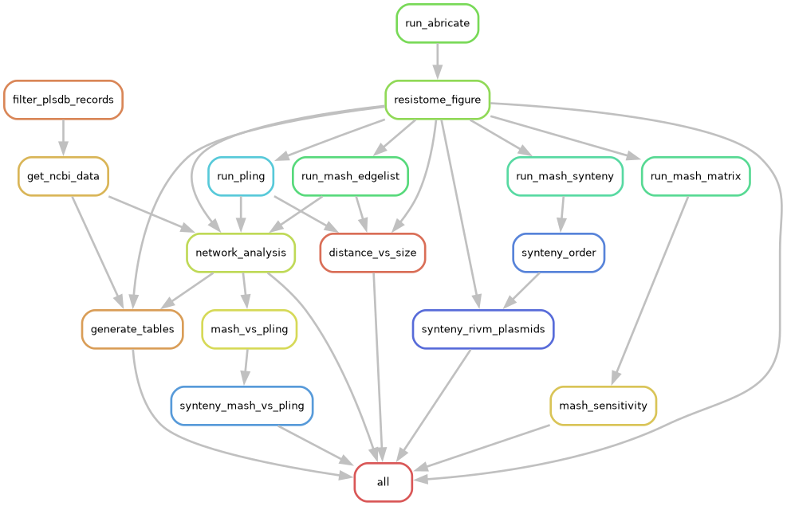

# cfr-plasmid-analysis

Snakemake workflow for manuscript as supplementary methods.

## Overview

This repository contains scripts, notebooks, and environment files as a Snakemake workflow, accompanying the manuscript:

> Diversity and host association of cfr-carrying plasmids of multidrug-resistant microorganisms from the Netherlands 
>
> Thera Habben Jansen, Simon Lansu, Kees T. Veldman, Peter C. Wever, Fabian Landman, Heiman F.L. Wertheim and Antoni P.A. Hendrickx
>
> Corresponding author: Antoni P.A. Hendrickx [antoni.hendrickx@rivm.nl]

All scripts are implementations of publicly available tools and software and contains no original software/tools.

## Installation

Clone this repository and install dependencies using conda.

```bash
git clone https://github.com/rivm-syso/cfr-plasmid-analysis.git
cd cfr-plasmid-analysis
conda env create -f workflow/envs/manuscript.yaml
```

Dependencies are handled through Snakemake, using conda.
The database used by `bakta` should be installed manually, see [Bakta documentation](https://bakta.readthedocs.io/en/latest/cli/database.html).

### Configuration

configuration is done through the `config/config.yaml` file.
This file should contain the path to the installed bakta database.

The workflow uses the Entrez api for retrieving information from NCBI.
A yaml file should be provided with at least `email: your@email.com`, but also using an NCBI api-key is recommended, `api_key: YOURAPIKEY`

#### Workflow profile

The workflow is set up to be used on a LSF cluster, when using a different cluster or running locally the profiles in `workflow/profile` should be adapted accordingly.

## Usage

Activate the conda environment and run snakemake to do, everything!

```bash
snakemake --profile workflow/profile/default
```

### Workflow rulegraph



## Data

### Data availability

Pseudonymized hybrid assemblies and metadata from the national surveillance is made available under resources in this repository.
PLSB records were retrieved using the [web interface](https://ccb-microbe.cs.uni-saarland.de/plsdb2025/search) of PLSB, the export files of this query are present in the resources folder of this repository.
Raw sequencing data will be made available through NCBI.

## Licence

This repository is licenced under [EUROPEAN UNION PUBLIC LICENCE v. 1.2](https://eupl.eu/1.2/en/)

## Contact

For questions about this repository, contact: Simon Lansu at [simon.lansu@rivm.nl]